# FA Reporter - Agile Software Requirement Specification

## 1. Project Overview
**FA (Fixed Asset) Reporter** is a mobile application pitched to streamline the inventory counting and fixed asset reporting process for warehouse and field teams. Rather than relying on manual data entry or specialized legacy scanning hardware, this app utilizes modern smartphone capabilities to identify assets via camera text reading, verify them against a secure local database, gather location and condition data, and generate shareable Excel reports on the go. 

This document outlines the agile evolution of the application's requirements across five development cycles. It demonstrates the initial requirements gathering, collaborative troubleshooting, and the progressive expansion of features, simulating the dialogue between a non-technical Product Owner and the Requirement Engineer.

---

## 2. The Agile Process: Conversations

To simulate the agile development process, the following section details the iterative conversations between the Product Owner (PO) and the Requirement Engineer (RE) across five development sprints.

### Cycle 1: Initial Pitch & Basic Camera Concept
**Product Owner:** Hi! I'm really excited to get this project started. Right now, our warehouse staff is doing inventory counting completely on paper. We have over 10,000 fixed assets—like forklifts, manufacturing machines, and IT equipment. It takes weeks to manually write down all those numbers, and typos are a nightmare. We need a mobile app where they can just point their phone at a piece of equipment, and the app reads the printed number on the tag. Also, our warehouse is massive and the back aisles have absolutely zero Wi-Fi or cellular service. So, the app needs to hold our entire confidential equipment list inside it somehow, and it has to work completely offline.

**Requirement Engineer:** Hello! That sounds like a perfect use case for a mobile application. To solve the data entry problem, we can use the phone's camera to read the text off the labels. To handle the offline requirement and keep your company's data safe, we will embed your equipment list securely inside the app using an encrypted local database. When the user opens the app, they'll authenticate, which unlocks the data. We'll start by building a main home screen, a camera screen to read the tags, and a simple way to save the recognized text to the database.

**Product Owner:** That is fantastic! I love the idea of using the camera instead of buying those expensive barcode scanners. And the encrypted offline database sounds exactly like what our security team would want. Don't worry if the camera isn't 100% perfect on day one, we just need a solid prototype to get the warehouse team testing it.

### Cycle 2: Formatting the Scanned Text & Handling Edge Cases
**Requirement Engineer:** We built the first version and took it for a spin! The camera reads the text successfully, but we ran into a few minor hiccups during our internal testing. Sometimes it accidentally reads the number twice if the user holds the camera over the tag for too long. We also noticed it occasionally picks up other random words printed on the tag, like "WARNING" or the manufacturer's name. On top of that, we saw that some of your older tags have slightly different numbering formats compared to the newer ones.

**Product Owner:** Oh, I'm so glad you caught that! Yes, our older machines have tags that start with "EQ-" followed by numbers, while the new ones just have a 7-digit number. It's totally fine that it's picking up extra words right now; it's honestly just amazing that it can read the text at all. Could we maybe have the app filter out the extra words and just look for those two specific patterns our asset numbers use? Also, what happens if a staff member gets distracted and scans the exact same tag twice by accident? Or what if they forget to hit save?

**Requirement Engineer:** Great questions. Yes, we will add a "smart text filter" to the camera module. It will be trained to only grab the text that matches your "EQ-" pattern or the 7-digit pattern, completely ignoring words like "WARNING." To handle the human errors, we will add some safety checks: if they scan an item that's already been counted in their session, the app will pop up a warning saying it's a duplicate. We'll also ensure that if they leave any required fields empty, the "Save" button will be blocked until they fill them out.

### Cycle 3: User Data Entry & Location Matching
**Product Owner:** The smart filtering is working beautifully, the guys on the floor love it! But finding the item is only half the battle for us. When they scan an item, they also need to tell us what shape it's in. Some machines are broken, some need maintenance, and some are perfectly fine. Can we have a screen where they can select or type in the "Condition" of the asset? Furthermore, our database knows where the asset *should* be—like Aisle 4. But they might find it in Aisle 9 because someone moved it. I want them to enter where they *actually* found it, which we'll call the "Scanned Location".

**Requirement Engineer:** Absolutely, we can definitely expand the data we collect. Here is the new flow: Once the camera reads the item, we'll pop up a confirmation dialog box showing the item details pulled from your secure database (like its name and its "Expected Location"). Once they confirm it's the right item, we will take them to a dedicated Data Entry screen. Here, they will find fields to type in the "Condition" and the "Scanned Location". When they save, we'll store this new information alongside the original database records.

**Product Owner:** That sounds brilliant! Being able to compare the expected location with the scanned location right in the app is going to save us so much time tracking down lost equipment. 

### Cycle 4: Reviewing Previous Entries
**Requirement Engineer:** The data entry screens are fully implemented and the location matching is working smoothly. However, as we were testing a full 8-hour shift workflow, we realized the users might get lost in their own progress. If a worker gets pulled away for an hour, they might forget which items they've already scanned.

**Product Owner:** Oh, wow, yes! I completely forgot about that. The warehouse floor is chaotic, and they get interrupted all the time. Is there a way they can see a history of what they did that day? Like a list of everything they counted so far in their current shift, just in case they want to double-check their work before finishing up?

**Requirement Engineer:** Yes, we can easily pull that from the local database. We'll add a "Previous Entries" screen. We can put a button for it right on the main home screen. It will show a scrollable list of everything they've counted in their current session, displaying the asset ID, the condition they entered, and the location. This way, they can always verify their progress.

### Cycle 5: Excel Export & In-App Editing
**Product Owner:** Everything is coming together perfectly! There's just one last piece of the puzzle. Right now, at the end of the shift, the staff bring me their paper clipboards and I spend three days typing it all into Excel for the accounting department. Can the app just make an Excel file when they are done? Also, sometimes the guys realize they made a typo on the Condition field right at the end of their shift. Instead of deleting it and scanning it again, can they view and edit the spreadsheet inside the app before sending it to me?

**Requirement Engineer:** Definitely, eliminating that manual data entry is the main goal here. We'll add a final "End Counting" process. When they tap this, the app will compile all their session data and generate a properly formatted Excel spreadsheet. Before it exports the file, we'll open an Excel-like View screen right on their phone. They can tap on any cell to edit typos or fix a location. Once they are happy with the spreadsheet, they can tap a "Share" button to email it directly to you or send it via a messaging app.

**Product Owner:** Wow, you guys really thought of everything! The ability to fix a typo right in the app before emailing the Excel file is going to make everyone's life so much easier. I can't wait to roll this out!

---

## 3. Evolution of Requirements (Diagrams)

Below is the evolution of the system's architecture and user workflows over the 5 agile cycles. Each cycle now includes three perspectives:
1. **Use Case Diagrams**: Showing what the user can accomplish.
2. **Screen Flow Diagrams**: Showing the navigation paths between UI screens.
3. **UML Class Diagrams**: Showing the underlying software architecture.

### Cycle 1: Baseline (Basic Camera OCR)

*The initial concept establishing the offline secure database and basic camera reading.*

**Use Case Diagram:**
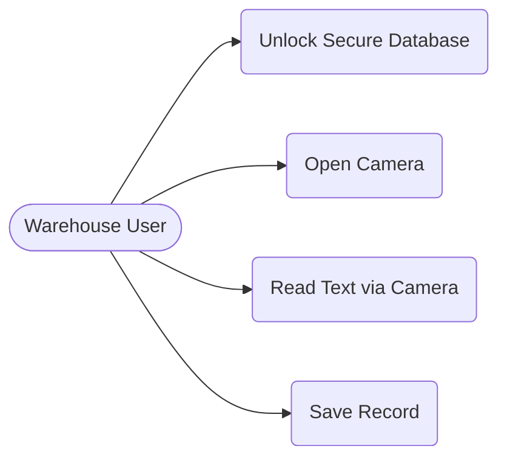

**Screen Flow Diagram:**
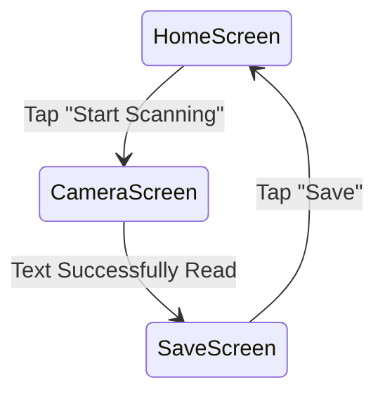

**UML Class Diagram:**
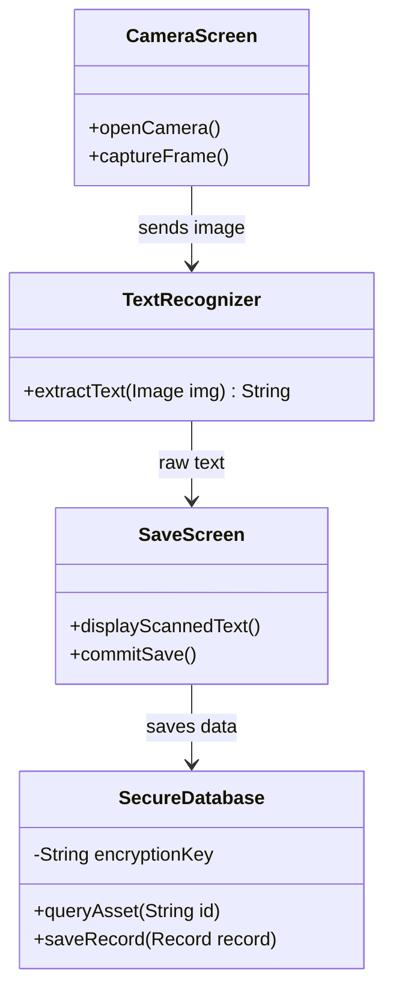

### Cycle 2: Text Filtering & Validations

*Added smart filtering for different numbering formats and validation rules for empty fields and duplicates.*

**Use Case Diagram:**
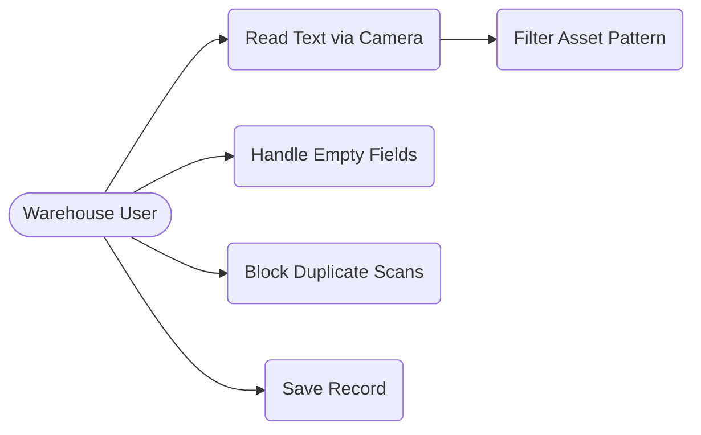

**Screen Flow Diagram:**
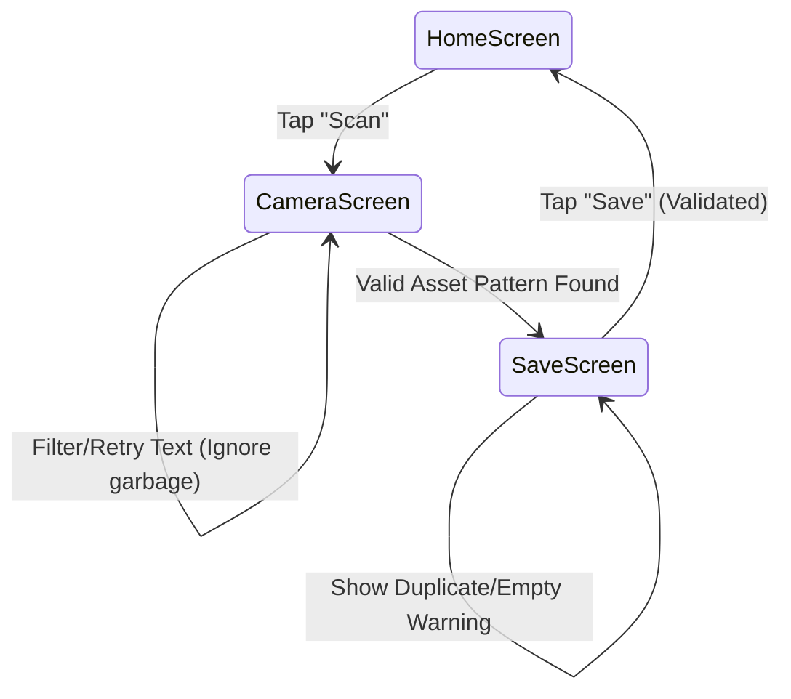

**UML Class Diagram:**
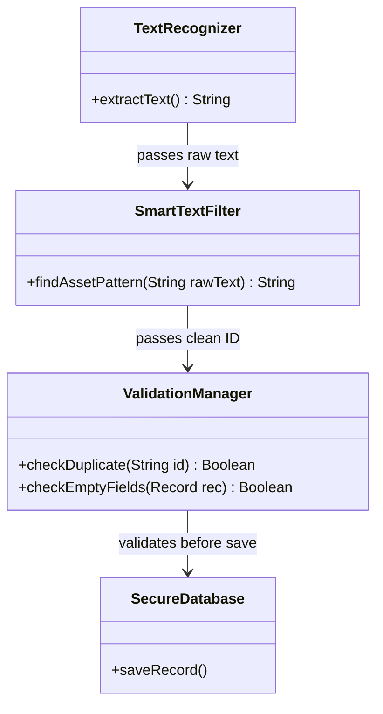

### Cycle 3: Data Entry & Location Matching

*Expanded the Save process into a detailed dialog and Data Entry screen for Condition and Location tracking.*

**Use Case Diagram:**
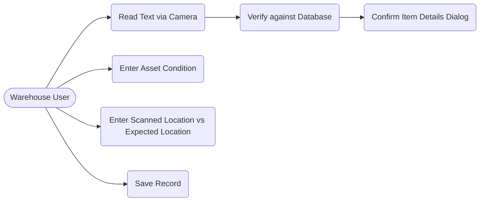

**Screen Flow Diagram:**
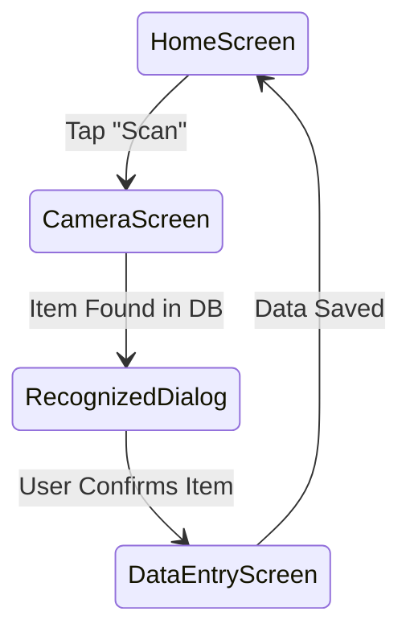

**UML Class Diagram:**
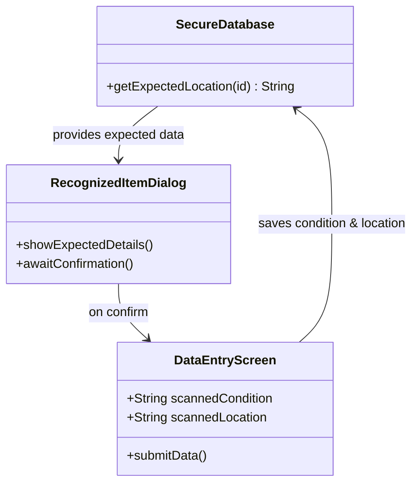

### Cycle 4: Session Review

*Added the ability to view the current session's scanned items.*

**Use Case Diagram:**
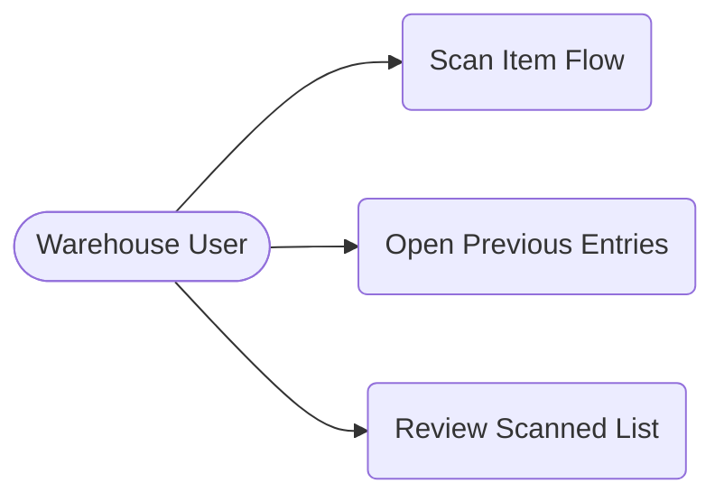

**Screen Flow Diagram:**
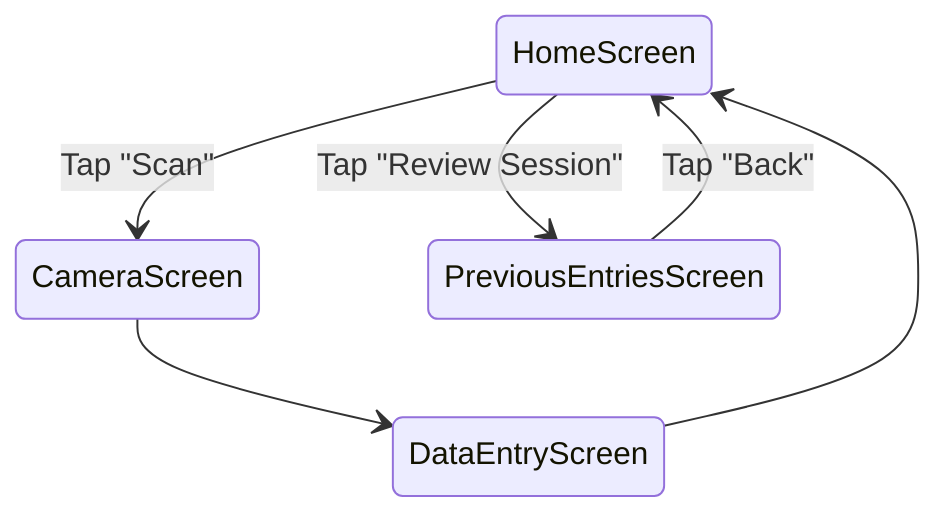

**UML Class Diagram:**
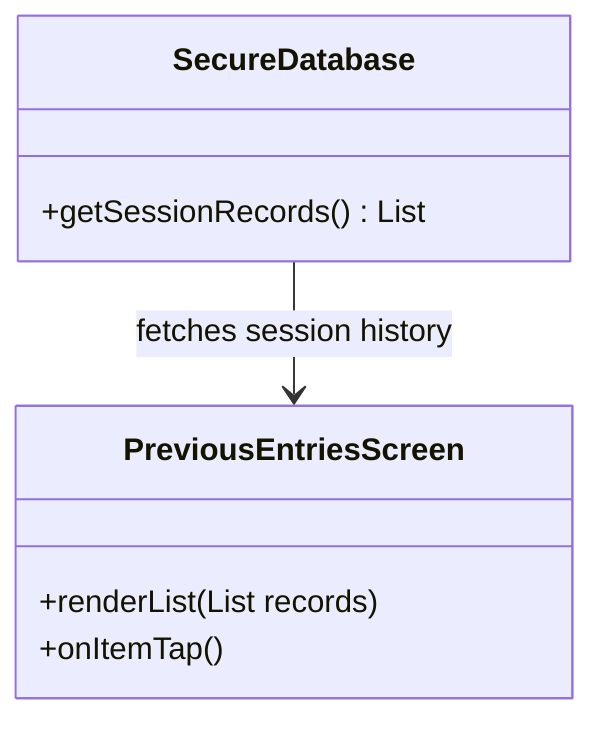

### Cycle 5: Excel Finalization (Final)

*Added the final export process allowing in-app Excel editing before sharing.*

**Use Case Diagram:**
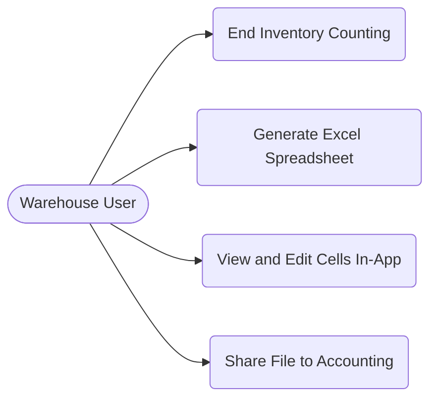

**Screen Flow Diagram:**
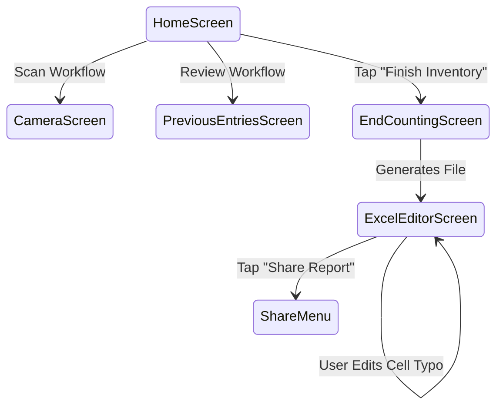

**UML Class Diagram:**
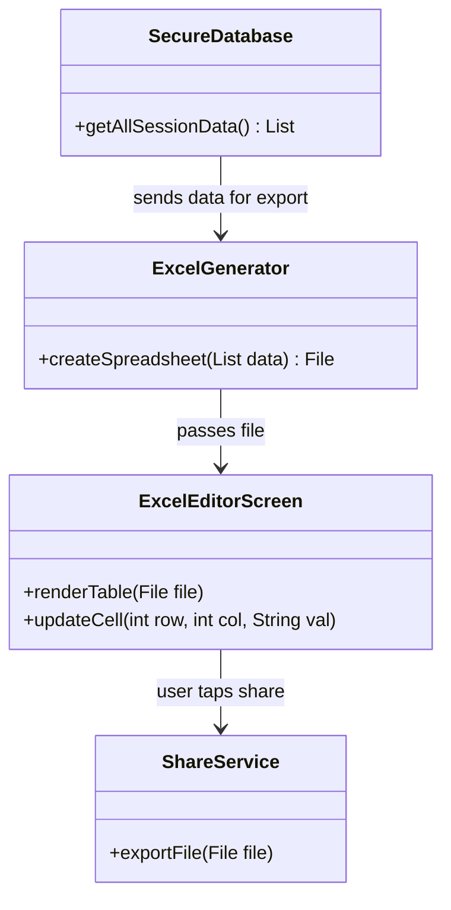

---

## 4. Final Software Requirement Specification (High-Level)

Based on the finalized Cycle 5 iterations, here are the high-level requirements for the FA Reporter application.

### 4.1. Core Features
1. **Secure Offline Verification**: The app shall embed an encrypted, locally stored database containing the company's equipment list to operate entirely offline in warehouse environments.
2. **Smart Camera Reader**: The app shall use the camera to read text from equipment tags and automatically extract specific asset numbering patterns while ignoring surrounding garbage text.
3. **Data Validation**: The app shall prevent users from saving empty fields and warn them if they attempt to scan a duplicate asset ID.
4. **Detailed Data Entry**: Upon recognizing an ID, the app shall present a dialog confirming the asset details, followed by a screen where the user inputs the asset's current "Condition" and the "Scanned Location" (to be compared against the "Expected Location").
5. **Session Review**: Users shall be able to access a "Previous Entries" list to review all items they have counted during their current shift.
6. **In-App Excel Editing & Export**: The app shall provide an "End Counting" flow that generates a formatted Excel spreadsheet. Users shall be able to view and modify cell data directly within the app before exporting it via native share menus.

### 4.2. User Interface Workflow
- The user begins at the **Home Screen** where they can choose to Scan, Review, or End Counting.
- The **Camera Screen** handles real-time text recognition and pattern matching.
- A **Recognized Item Dialog** bridges the camera and data entry, ensuring the correct item was found.
- The **Data Entry Screen** collects the user's observations (Condition, Location).
- The **Previous Entries Screen** provides a scrollable history of the session.
- The **End Counting Screen** and **Excel Editor Screen** handle data finalization, typo correction, and sharing.
